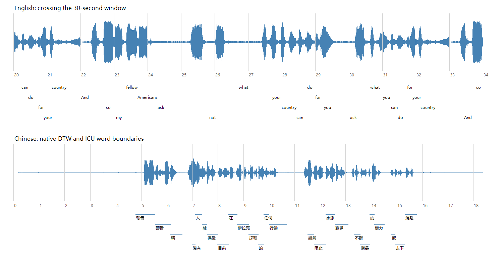
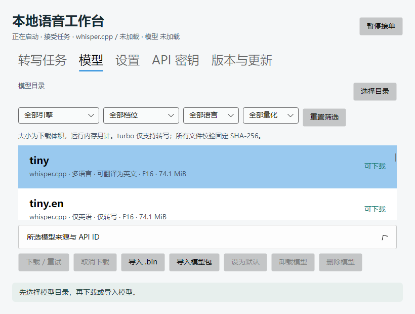

# 双引擎验收记录（2026-10-29）

本次通过 CPU 路径验收：33 个 whisper.cpp 文件和 12 个 CTranslate2 模型包均完成可信摘要校验、原生加载、JFK 短音频转写和词时间戳输出。模型管理、四语言、长音频、生命周期、桌面与两种发行形式的结果见下文。**CUDA 真机验收未完成**，ROADMAP 对应条目保持未勾选。

原始结果的可移植快照见 [验证数据](verification/dual-engine-2026-10-29.json)。完整运行日志、模型和安装包留在本机 `artifacts/`，不随源码或正式安装包分发。本次使用的 `0.1.2` 是本地升级验证版本，没有创建 Git tag、推送或发布 GitHub Release。

## 环境与版本

- Windows 11 x64，Intel Core Ultra 7 165U，12 核 / 14 逻辑处理器，约 32 GB RAM；只有 Intel Graphics。
- .NET SDK 10.0.301；Whisper.net 1.9.1；CTranslate2 4.6.0，固定提交 `617405f4b050e994e829d527da6caa0e0030afe7`。
- CTranslate2 使用 C++ C ABI 桥接、Ruy CPU 后端，MSVC 14.44 构建；桥接和依赖版本、许可证、二进制摘要随源码与验证数据记录。
- CPU 测试最多 8 个推理线程。CTranslate2 模型目录的 F16 是存储格式；目录回归请求 `int8`，原生实际精度为 `int8_float32`。
- Windows Sandbox 关闭网络与 vGPU，分配 8 GB RAM；运行自包含应用和原生 DLL，不安装 .NET SDK、Python 或 C++ 编译工具。

## 已实测模型组合

| whisper.cpp 档位 | 多语言 / 英语专用 | 已验证文件格式 |
| --- | --- | --- |
| tiny | 两者 | F16、Q5_1、Q8_0 |
| base | 两者 | F16、Q5_1、Q8_0 |
| small | 两者 | F16、Q5_1、Q8_0 |
| medium | 两者 | F16、Q5_0、Q8_0 |
| large-v1 | 多语言 | F16 |
| large-v2 | 多语言 | F16、Q5_0、Q8_0 |
| large-v3 | 多语言 | F16、Q5_0 |
| large-v3-turbo | 多语言 | F16、Q5_0、Q8_0 |

CTranslate2 的 12 个模型包是 tiny、base、small、medium 各自的多语言及 `.en` 版本，以及 large-v1、large-v2、large-v3、large-v3-turbo。每包校验权重、配置、分词器、词表及目录列出的其他必需文件；未要求本机转换模型。

GGML 固定来源修订为 `5359861c739e955e79d9a303bcbc70fb988958b1`，文件大小和 SHA-256 见 [WhisperCatalog.cs](../src/AiLocalApi.Core/WhisperCatalog.cs)。CTranslate2 各仓库修订、完整文件清单和摘要见 [ctranslate2-catalog.json](../src/AiLocalApi.Core/ctranslate2-catalog.json)。没有为上游不存在的组合生成选项，例如本目录不含 large-v3 Q8。

这些逐项测试证明本机 CPU 的加载与基本转写兼容性，不代表每个模型的全部语言、长音频或 GPU 都已测试。四语言和跨窗口回归使用下述代表模型。

## 行为与故障回归

| 范围 | 结果与证据 |
| --- | --- |
| 单元及桌面测试 | 49 项通过，0 失败、0 跳过；包括旧 JSON 默认值、模型能力、别名绑定、诊断与任务互斥、筛选空结果、精度选择及布局 |
| 模型下载 | 实际下载固定文件并逐项加载；本地 HTTP 故障夹具验证取消、去重、重启后 Range 续传、损坏 tokenizer 拒绝、重试成功 |
| 离线导入与删除 | 中文目录导入、逐文件验证、复制后的再次验证、占用保护及额外文件拒绝删除；来源目录保留 |
| 磁盘不足 | 单元测试覆盖单文件与模型包；Sandbox 另创建 64 MB 独立 NTFS 虚拟盘，权重下载前返回 `disk_full`，未登记残缺模型 |
| 模型能力 | `.en` 拒绝非英语和翻译；turbo 拒绝英文翻译；旧词表拒绝显式 `yue`；默认模型变化不改写已提交任务 |
| 转写流程 | 中、日、英、韩指定语言及自动检测；初始提示、温度 0 / 非零、中文到英文翻译、数字静音空输出 |
| 长音频 | 44 秒样本含四次 JFK 讲话，四次均保留；词时间跨过 30 秒，文本对应且时间顺序正确 |
| 生命周期 | 同模型复用、引擎切换、空闲 TTL、手动卸载、取消后回收、重试、杀死 Worker 后自动恢复、宿主退出与端口释放 |
| 异常隔离 | 损坏模型和缺失原生 DLL 返回诊断，同一宿主随后可成功转写；中文模型路径经过实际原生加载 |
| API | 官方 OpenAI .NET SDK、异步任务、鉴权与错误结构；json、text、srt、vtt、verbose_json；分段及词时间戳 |
| 设备诊断 | 诊断与任务共享执行锁，先释放空闲驻留模型；CPU float32 / int8 实际精度可见；auto 失败后提示回退；CPU 构建显式 CUDA 返回错误，未冒充 GPU 成功 |

词边界按原生交叉注意力 DTW 对齐后进行 ICU 分词。波形抽样发现并修复了前导停顿被归入首词的问题；修正保留原生结束时间，用同窗口词时长中位数限制异常起点。它仍是启发式对齐，不能替代人工标注。下图检查中文前导停顿和英文跨窗口位置：



## 四语言质量记录

固定样本和参考文本来自 Google FLEURS（Conneau et al., 2022，CC-BY-4.0），修订、归档内路径和 SHA-256 见 [夹具清单](../scripts/multilingual-fixtures.json)。每种语言均执行指定语言和自动检测，识别语言一致，时间范围、词序、Unicode 和词文本对应检查通过。

以下为指定语言的单样本字符错误率（CER）。归一化仅做 NFKC、小写及保留字母数字；不进行繁简转换，也不把“200”和文字数字视作同值，因此不能用这四条样本代表整体语言质量。自动检测结果和每次耗时保存在验证 JSON 中；大模型回归与其他验证并行，耗时不用于下面的性能比较。

| 语言 | ct2-tiny | ct2-large-v3-turbo |
| --- | ---: | ---: |
| 中文 | 29.55% | 0.00% |
| 日文 | 26.09% | 4.35% |
| 英文 | 1.56% | 0.00% |
| 韩文 | 18.33% | 5.00% |

## CPU 性能观察

使用自包含 Release 构建和同一 11 秒 JFK 音频，tiny 多语言 F16 存储模型，显式英语、温度 0、无提示、不开词时间戳、8 线程。冷运行指新 Worker 加载后的第一次请求，包含摘要验证、启动、解码与推理；热运行复用同一 Worker 和模型。操作系统文件缓存未清空，每项仅测一次，记录的是端到端观察值，不是统计基准。

| 引擎 / 实际计算精度 | 解码策略 | 冷运行 | 热运行 | 冷 / 热阶段 Worker 峰值 RAM |
| --- | --- | ---: | ---: | ---: |
| whisper.cpp / F16 文件 | 默认 greedy | 3.75 s | 0.82 s | 286.9 / 291.5 MiB |
| CTranslate2 / int8_float32 | beam size 5 | 5.51 s | 1.28 s | 314.5 / 333.6 MiB |
| CTranslate2 / float32 | beam size 5 | 4.93 s | 1.00 s | 418.9 / 492.8 MiB |

峰值取 Worker 的 `PeakWorkingSet64`，不包含桌面宿主。该样本的三种配置均保留完整讲话文本，标点略有差异。解码策略不同，不能将比值解释为引擎本身的普遍速度差；INT8 在这个短样本上也没有比 float32 更快。未测 GPU，VRAM 无数据。

## 发行与升级

最终本地输出位于 `artifacts/publish/dual-reviewed` 和 `artifacts/releases/dual-reviewed`。NSIS 安装器、便携 ZIP、Velopack 完整包及更新索引四项产物的版本和摘要核对通过；精确摘要保存在验证 JSON 中。

在离线 Sandbox 内，分别从旧版 0.1.1 升级到本地验证版 0.1.2，使用实际中文和空格路径 `T:\安装 中文目录`、`T:\便携 中文目录`。两种形式均保留原配置、tiny 模型及历史任务，不自行启用登录启动；升级后 whisper.cpp 与 CTranslate2 CPU 转写、官方 SDK、五种 HTTP 输出、宿主重启恢复通过。CTranslate2 模型从只读共享目录复制后离线加载。

双形态升级与 API 全量回归使用 `dual-accepted` 批次；随后完成的诊断互斥修正另外通过 49 项测试、真实原生诊断和 `dual-reviewed` 最终自包含包的 Sandbox CPU 复验。两批的原生依赖一致，验证快照分别保留产物摘要，避免混淆验收批次。

模型页已在 820×620 和 1080×760 检查。模型大小明确为下载体积，运行内存另计；后端与精度按引擎显示，保留默认模型及 `whisper-1` 用法。



## 复现

先按 [引擎说明](SPEECH-ENGINES.md) 构建运行库、准备音频夹具并选择存储目录。目录全量回归会下载数十 GiB 模型；使用新数据目录可以避免复用之前的验收检查点。

```powershell
./scripts/test.ps1
$env:AILOCAL_WORKER = "$PWD/src/AiLocalApi.Worker/bin/Debug/net10.0-windows/AiLocalApi.Worker.exe"
$verify = "$PWD/tools/AiLocalApi.Verify/bin/Debug/net10.0-windows/AiLocalApi.Verify.dll"
dotnet $verify --catalog artifacts/check-ggml artifacts/models artifacts/fixtures/jfk.wav
dotnet $verify --bundle-catalog artifacts/check-ct2 artifacts/models artifacts/fixtures/jfk.wav
dotnet $verify --dual-suite artifacts/check-dual artifacts/models artifacts/fixtures
dotnet $verify --multilingual-engine artifacts/check-turbo artifacts/models artifacts/fixtures ct2-large-v3-turbo
dotnet $verify --bundle-failures artifacts/check-failures artifacts/models/ct2-tiny
```

性能观察应使用 `publish.ps1` 的自包含 Release Worker 和 Verify，调用 `--benchmark <新数据目录> <模型目录> <jfk.wav>`。CI 已接入 tiny 双引擎 CPU 冒烟测试；本轮没有推送或触发远程 GitHub Actions。

## 保留的边界

CTranslate2 是 C++ 推理实现；Faster Whisper 是建立在其上的 Python 转写流程。本项目通过 C++ 接口调用 CTranslate2，并自行实现特征、分词和窗口处理，不安装或执行 Faster Whisper Python 包。没有提供原始 PyTorch Whisper 引擎，不承诺与两者逐字一致；当前也没有 VAD、批量推理、说话人分离或实时流式能力。

CUDA 的选择、错误诊断及构建入口已实现，但当前机器没有 NVIDIA GPU 或 CUDA/cuDNN 工具链。尚未验证 CUDA 原生构建、具体依赖版本组合、GPU FP16/INT8 推理、释放和峰值显存；不得把 CPU 测试结果作为 CUDA 验收结果。
